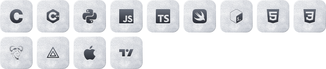

 

 

## ◉ Selected work

<table>
  <tr>
    <td width="50%" valign="top">
      <h3><a href="https://github.com/windowopner/studyos">StudyOS</a> source</h3>
      <code>Next.js 16</code> · <code>Supabase</code> · <code>Claude API</code>  
      A whole school week in one app: assignments, notes, flashcards, to-dos, and an AI tutor that builds decks for you. Study rooms check passwords and roles inside the database (bcrypt, RLS, <code>SECURITY DEFINER</code>), so the browser is never trusted.
    </td>
    <td width="50%" valign="top">
      <h3><a href="https://github.com/windowopner/undertone">Undertone</a> source</h3>
      <code>Swift</code> · <code>ScreenCaptureKit</code> · <code>SceneKit</code>  
      A macOS desktop wallpaper that listens. It captures system audio with ScreenCaptureKit, splits it into 16 bands with a bank of band-pass filters, tracks the beat, and drives nine visual styles in SwiftUI and SceneKit, tinted by the album art of whatever is playing.
    </td>
  </tr>
  <tr>
    <td width="50%" valign="top">
      <h3><a href="https://project-km7wz.vercel.app">Folio</a> live</h3>
      <code>JavaScript</code> · <code>Supabase</code>  
      A publishing platform for essays, letters, and poems: @handles, follows, likes, comments, bookmarks, and version history, behind Google sign-in and row-level security.
    </td>
    <td width="50%" valign="top">
      <h3><a href="https://github.com/windowopner/pumpfun-trial-1">pumpfun-trial-1</a> source</h3>
      <code>Python</code> · <code>Solana</code> · <code>SQLite</code> · <code>Streamlit</code>  
      Do memecoin sniping bots make money? Records every Pump.fun launch and trade, reproduces 2.3 million real trades to the lamport, and backtests against a random baseline. Buying at launch loses, even before fees.
    </td>
  </tr>
  <tr>
    <td width="50%" valign="top">
      <h3>WebGL Ripple</h3>
      <code>Three.js</code> · <code>GLSL</code>  
      Water you can touch. The 2D wave equation is solved on the GPU every frame, ping-ponging between 512×512 half-float textures, then turned into normals and lit in a shader.
    </td>
    <td width="50%" valign="top">
      <h3><a href="https://github.com/windowopner/MCP-test">Workspace Connector</a> archived</h3>
      <code>Python</code> · <code>FastAPI</code> · <code>OAuth 2.1</code>  
      A remote MCP server that let Claude work in my Google account: 12 tools across Classroom, Drive, Docs, and Slides. Its own OAuth 2.1 server with dynamic client registration, PKCE, and rotating refresh tokens.
    </td>
  </tr>
</table>

### ▶ [This portfolio](https://windowopner.github.io)

*Six projects as iridescent discs on a mirror floor. Every disc is a record with its own loop synthesised in the browser — the carousel is the crossfader, and you can scratch the front disc.*

## ◉ Toolkit

**Languages**

<picture>
  <source media="(prefers-color-scheme: dark)" srcset="assets/icons/languages.svg">
  
</picture>

 

**Web &amp; Backend**

<picture>
  <source media="(prefers-color-scheme: dark)" srcset="assets/icons/web.svg">
  
</picture>

<picture>
  <source media="(prefers-color-scheme: dark)" srcset="assets/icons/backend.svg">
  
</picture>

 

**Linux &amp; Security**

<picture>
  <source media="(prefers-color-scheme: dark)" srcset="assets/icons/linux.svg">
  
</picture>

 

**Hardware &amp; Embedded**

<picture>
  <source media="(prefers-color-scheme: dark)" srcset="assets/icons/hardware.svg">
  
</picture>

 

**Tools**

<picture>
  <source media="(prefers-color-scheme: dark)" srcset="assets/icons/tools.svg">
  
</picture>

My dev setup lives in <a href="https://github.com/windowopner/dotfiles">dotfiles</a>: Ghostty, Catppuccin Mocha, SSH-signed commits.

## ◉ Stats

<picture>
  <source media="(prefers-color-scheme: dark)" srcset="https://github-readme-stats.vercel.app/api?username=windowopner&show_icons=true&hide_border=true&bg_color=00000000&rank_icon=github&title_color=c0c4cc&icon_color=c0c4cc&text_color=c9d1d9&ring_color=c0c4cc">
  
</picture>
<picture>
  <source media="(prefers-color-scheme: dark)" srcset="https://github-readme-stats.vercel.app/api/top-langs/?username=windowopner&layout=compact&hide_border=true&bg_color=00000000&langs_count=6&title_color=c0c4cc&text_color=c9d1d9">
  
</picture>

 

